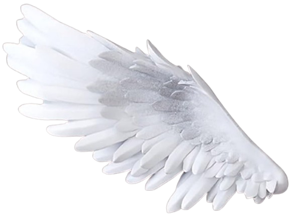
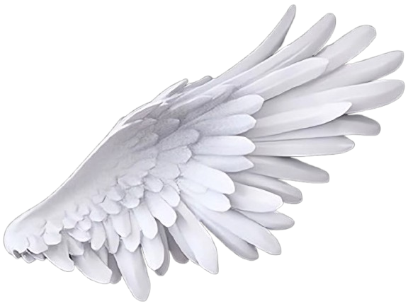
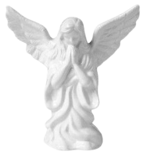

 
  &nbsp;&nbsp;
  
  &nbsp;&nbsp;
  

 $\color{#e4e4e2}\textsf{໒꒱ angel :}$
$\color{#e3e3e1}\textsf{a luminous, celestial entity carved from pure spirit and immortal light, existing in the spaces between the mortal world and the infinite divine.}$ $\color{#e3e3e1}\textsf{They are the cosmic architects of fate, the silent guardians of the universe,}$ $\color{#e3e3e1}\textsf{and the soaring messengers who bridge the gap between heaven and earth.}$

  

 

 
 <a href="https://guns.lol/anyujins">guns.lol</a> $\color{#b6b6b4}\textsf{   ⋆}$ <a href="https://en.pronouns.page/@nmixes">prns.pg</a></a>
